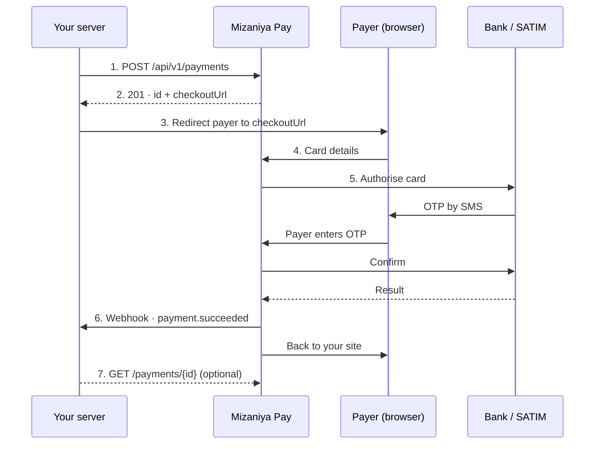

The four parties are **your server**, **Mizaniya Pay**, **the payer's browser** and **the bank / SATIM**.

<Steps>
  <Step title="Register">
    Your server calls [`POST /api/v1/payments`](/api-reference/register-payment) with the amount in centimes and your order reference.
  </Step>
  <Step title="Receive id and checkoutUrl">
    We answer `201` with the payment `id` and the hosted `checkoutUrl`.
  </Step>
  <Step title="Redirect">
    Send the payer to the `checkoutUrl`. It is shown only once.
  </Step>
  <Step title="Payer pays">
    The payer enters their card details on our page, then the OTP their bank sends by SMS.
  </Step>
  <Step title="Get the result">
    A [signed webhook](/webhooks/overview) hits your server. You can also call [`GET /payments/{id}`](/api-reference/get-payment) for confirmation and a receipt.
  </Step>
  <Step title="Fulfil">
    Ship the order when the status is `success`.
  </Step>
</Steps>

<Note>
The payer has a **15-minute** window to complete the payment, and gets **3 card attempts** per payment, each with **3 OTP tries**.
</Note>
