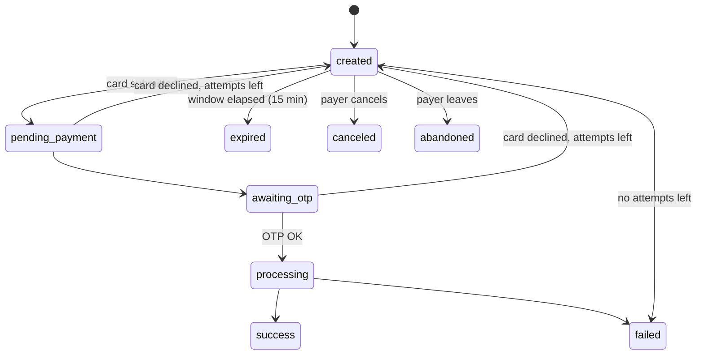

<Warning>
Only `success` means you have been paid. Once a payment reaches a final status it never changes again.
</Warning>

## Lifecycle

## What to do in each status

| Status | Final | What you do |
|---|---|---|
| `created` | No | Wait. If the last card was declined, `error` says why and the payer can retry. |
| `pending_payment` | No | Wait: card submitted. |
| `awaiting_otp` | No | Wait: payer is typing the bank code. |
| `processing` | No | **Hold the order.** The card may already be charged. It always ends in `success` or `failed`. |
| `success` | Yes | Paid: fulfil the order. |
| `failed` | Yes | Not paid. See `error.code`. Retry with a new payment. |
| `expired` | Yes | Window closed. Register a new payment if needed. |
| `canceled` | Yes | The payer canceled on the checkout page. Not paid. |
| `abandoned` | Yes | The payer left the checkout page. Not paid. |

<Info>
The payer gets 3 card attempts per payment, each with 3 OTP tries.
</Info>
